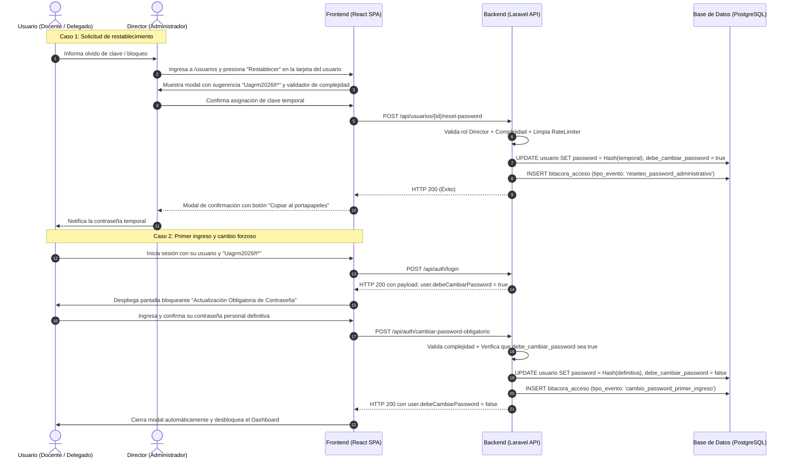
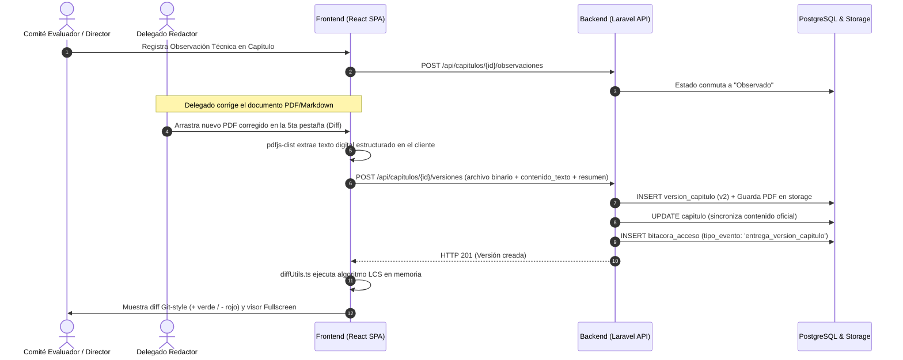

# Bitácora de Cambios Técnicos y Flujos de Seguridad (Changelog)

**Fecha:** 17 de noviembre de 2026  
**Proyecto:** Seguimiento al Diseño Curricular (Carrera de Ingeniería en Sistemas - UAGRM)  
**Propósito del documento:** Servir como guía de traspaso técnico (*handover*) para que los colaboradores del equipo (Carlos, Tania, Luis) comprendan exactamente qué cambios se realizaron, por qué se implementaron, qué archivos intervienen y cómo verificar su operatividad en local.

---

## 1. Resumen de Requerimientos Implementados

Se blindó el sistema en los módulos de autenticación, control de acceso basado en roles (RBAC) y gestión de contraseñas conforme a los requerimientos institucionales de la materia:

1. **Política Estricta de Contraseñas (Complejidad y Longitud):**
   - Longitud obligatoria: **mínimo 8 y máximo 25 caracteres**.
   - Complejidad: debe contener al menos **una mayúscula (A-Z o Ñ)**, **una minúscula (a-z o ñ)**, **un dígito numérico (0-9)** y **un símbolo especial permitido (`@$!%*#?&_\-.`)**.
   - Soporte total para caracteres UTF-8 (`ñ`, `Ñ`).
   - Prohibición estricta de espacios en blanco y caracteres peligrosos.
   - Regex unificada en backend y frontend:
     `^(?=.*[a-zñ])(?=.*[A-ZÑ])(?=.*\d)(?=.*[@$!%*#?&_\-.])[a-zA-Z0-9ñÑ@$!%*#?&_\-.]{8,25}$`

2. **Mecanismo Anti Fuerza Bruta (Rate Limiting y Auditoría):**
   - Máximo **5 intentos fallidos** consecutivos por combinación `usuario|IP`.
   - En intentos fallidos previos (1 al 4): la API retorna código HTTP `401` informando cuántos intentos le quedan al usuario.
   - Al 5to intento fallido: la API bloquea el acceso temporalmente por **5 minutos (300 segundos)** con código HTTP `429 Too Many Requests`.
   - En el frontend: se despliega una **ventana emergente (modal de alerta)** y se deshabilita el botón de inicio de sesión con un temporizador regresivo en vivo (`mm:ss`).
   - Auditoría: se registra de forma inmutable el evento `bloqueo_fuerza_bruta` en la tabla `bitacora_acceso`.

3. **Blindaje de Rutas y RBAC Híbrido (403 Acceso Denegado):**
   - **Backend:** Se creó el middleware `App\Http\Middleware\CheckRole` (alias `'role'`) para proteger rutas administrativas como `/api/usuarios`, `/api/bitacora` y `/api/roles`, restringiéndolas exclusivamente al rol `Director`. Si un rol subordinado (Delegado, Invitado) las consulta, recibe un código HTTP `403 Forbidden`.
   - **Frontend:** Se creó el componente `<RoleProtectedRoute allowedRoles={['Director']}>` que envuelve las rutas `/usuarios` y `/bitacora`. Si un usuario sin privilegios escribe la URL en el navegador, se renderiza una pantalla con diseño formal `403 - Acceso Denegado` que muestra un contador regresivo de **3 segundos** y redirige automáticamente al `/dashboard`.

4. **Recuperación Administrativa de Contraseñas y Forzado de Cambio en Primer Ingreso:**
   - **Alternativa A institucional:** La recuperación no depende de servidores SMTP externos (evitando fallos de red en evaluaciones locales). El rol `Director` tiene la facultad exclusiva de restablecer la clave desde el módulo de usuarios.
   - El Director dispone de una sugerencia rápida institucional: `"Uagrm2026ñ*"`, o puede ingresar una personalizada siempre que pase el validador en tiempo real.
   - Al restablecer, el backend guarda el hash Bcrypt, levanta de inmediato cualquier bloqueo de fuerza bruta previo y activa la bandera `debe_cambiar_password = true`.
   - Cuando el usuario inicia sesión con la clave temporal, la SPA detecta la bandera y despliega un modal bloqueante obligatorio (`ForceChangePasswordModal.tsx`) que impide navegar por la plataforma hasta que ingrese y confirme su contraseña personal definitiva mediante el endpoint `POST /api/auth/cambiar-password-obligatorio`.

---

## 2. Diagrama del Flujo de Reseteo y Primer Ingreso

---

## 3. Matriz de Archivos Creados y Modificados

### Backend (Laravel)
| Archivo | Estado | Descripción técnica del cambio |
| :--- | :--- | :--- |
| `backend/database/migrations/2026_11_17_000001_add_debe_cambiar_password_to_usuarios_table.php` | **Nuevo** | Agrega la columna `debe_cambiar_password` (booleana, default `false`) a la tabla `usuario`. |
| `backend/database/migrations/2026_11_17_000002_create_versiones_capitulo_table.php` | **Nuevo** | Crea la tabla `version_capitulo` con claves foráneas a `capitulo` y `usuario`, almacenando número secuencial, ruta del binario en storage, texto estructurado y justificación. |
| `backend/app/Models/User.php` | Modificado | Registra `debe_cambiar_password` en `$fillable` y en `$casts` como booleano. |
| `backend/app/Models/VersionCapitulo.php` | **Nuevo** | Modelo Eloquent para la tabla `version_capitulo` con relaciones `capitulo()` y `usuario()`. |
| `backend/app/Models/Capitulo.php` | Modificado | Define la relación `versiones()` ordenada de forma descendente por `numero_version`. |
| `backend/app/Http/Middleware/CheckRole.php` | **Nuevo** | Middleware RBAC para validar roles en endpoints (`handle(Request $request, Closure $next, string ...$roles)`). Retorna `403` si el rol no coincide. |
| `backend/bootstrap/app.php` | Modificado | Registra el alias de middleware `'role' => CheckRole::class`. |
| `backend/app/Services/AuditBitacoraService.php` | Modificado | Agrega constantes y métodos: `registrarBloqueoFuerzaBruta()`, `registrarReseteoPasswordAdmin()`, `registrarCambioPasswordObligatorio()` y `registrarEntregaVersion()`. |
| `backend/app/Http/Controllers/Api/AuthController.php` | Modificado | 1. Implementa RateLimiter (5 intentos / 5 minutos) en `login()`. 2. Incluye `debeCambiarPassword` en respuestas de usuario (`login`, `me`, `actualizarPerfil`). 3. Agrega `resetPasswordUsuario()` para reseteo administrativo. 4. Agrega `cambiarPasswordObligatorio()` para el primer ingreso. |
| `backend/app/Http/Controllers/Api/ChapterController.php` | Modificado | Incorpora `listarVersiones()` (consulta con relaciones) y `storeVersion()` (valida PDF/MD/TXT de hasta 15 MB, incrementa versión atómica, guarda en storage, sincroniza texto con capítulo y registra auditoría). |
| `backend/app/Http/Requests/LoginRequest.php` | Modificado | Aplica reglas `min:8` y `max:25` con mensajes claros en español. |
| `backend/app/Http/Requests/StoreUserRequest.php` | Modificado | Validación con regex estricta al crear nuevos usuarios. |
| `backend/database/seeders/UsuarioSeeder.php` | Modificado | Actualiza contraseñas de demostración para cumplir con la nueva complejidad. |
| `backend/routes/api.php` | Modificado | Agrupa `/roles`, `/usuarios`, `/usuarios/{id}/reset-password`, `/bitacora` y `/bitacora/exportar` bajo `middleware('role:Director')`, registra `POST /api/auth/cambiar-password-obligatorio`, y agrega `GET` y `POST` para `/capitulos/{id}/versiones`. |

### Frontend (React SPA)
| Archivo | Estado | Descripción técnica del cambio |
| :--- | :--- | :--- |
| `frontend/package.json` | Modificado | Agrega la dependencia `pdfjs-dist` para extracción de texto estructurado en el cliente. |
| `frontend/src/types/index.ts` | Modificado | Incorpora `debeCambiarPassword?: boolean` en `User`, `debe_cambiar_password?: boolean` en `UsuarioBackend` y la interfaz completa `VersionCapitulo`. |
| `frontend/src/utils/diffUtils.ts` | **Nuevo** | Algoritmo LCS (*Longest Common Subsequence*) en TypeScript puro: calcula adiciones (+), eliminaciones (-) y líneas neutras con resumen estadístico. |
| `frontend/src/utils/pdfExtractor.ts` | **Nuevo** | Módulo de extracción de texto plano/markdown para archivos `.pdf` (configurado con Vite worker) y lectura directa para `.md` y `.txt`. |
| `frontend/src/components/chapters/ChapterDiffViewer.tsx` | **Nuevo** | Visualizador interactivo estilo Git con selectores independientes de versiones, cálculo de diferencias en vivo, enlaces de descarga y modal fullscreen. |
| `frontend/src/pages/ChapterDetail.tsx` | Modificado | Añade la 5ta pestaña **Historial de Versiones (Diff)**, zona Drag & Drop para subir entregas/subsanaciones protegida contra rol Invitado e integración con `ChapterDiffViewer`. |
| `frontend/src/context/AuthContext.tsx` | Modificado | Expone campos de respuesta en `login()`: `bloqueado`, `segundosRestantes` e `intentosRestantes`. |
| `frontend/src/components/auth/RoleProtectedRoute.tsx` | **Nuevo** | Componente que valida el rol del usuario conectado. Ante acceso no autorizado despliega pantalla `403` con cuenta regresiva en vivo de 3 segundos hacia `/dashboard`. |
| `frontend/src/components/auth/ForceChangePasswordModal.tsx` | **Nuevo** | Modal de alta prioridad (`z-[999]`) que bloquea el sistema si `user.debeCambiarPassword === true`, validando complejidad y confirmación en tiempo real. |
| `frontend/src/App.tsx` | Modificado | Integra `<RoleProtectedRoute allowedRoles={['Director']}>` en `/usuarios` y `/bitacora`, y monta `<ForceChangePasswordModal />` en la raíz protegida. |
| `frontend/src/pages/Login.tsx` | Modificado | Maneja respuesta `429`: modal de alerta por fuerza bruta, temporizador regresivo (`mm:ss`), botón deshabilitado y botones de prueba con contraseñas actualizadas. |
| `frontend/src/pages/UserManagement.tsx` | Modificado | Incorpora botón *"Restablecer Contraseña"* por tarjeta (excepto en cuenta propia), modal híbrido con sugerencia `"Uagrm2026ñ*"`, validador en vivo y botón para copiar clave. |
| `frontend/src/components/profile/EditProfileModal.tsx` | Modificado | Actualiza el validador en tiempo real con las 5 reglas institucionales de complejidad. |
| `README.md` | Modificado | Actualiza tabla de credenciales, políticas de seguridad y catálogo de endpoints a 38 rutas RESTful. |
| `.agents/arquitectura.md` | Modificado | Registra formalmente los ADRs `ADR-005`, `ADR-006` y `ADR-007`. |

---

## 4. Credenciales de Prueba Actualizadas

Todas las contraseñas cumplen la política (`min:8, max:25, mayúscula, minúscula, número, símbolo, UTF-8`):

| Usuario | Correo | Contraseña Actual | Rol |
| :--- | :--- | :--- | :--- |
| **`director`** | `grupo02sa@tecnoweb.org.bo` | `Director123!` | Director |
| **`cmarca`** | `marcacarlosestudio@gmail.com` | `Carlos123#` | Director |
| **`luisecv`** | `luis.ecv1111@gmail.com` | `Luis2026ñ#` | Director |
| **`tvalda`** | `taniavaldadonozo@gmail.com` | `Tania2026ñ!` | Director |
| **`croca`** | `croca@uagrm.edu.bo` | `Delegado2026ñ$` | Delegado |
| **`mmendoza`** | `mmendoza@uagrm.edu.bo` | `Invitado2026ñ*` | Invitado |

---

## 5. Guía de Pruebas Rápidas para el Colaborador

Para comprobar que todo funciona en tu máquina local:

1. **Prueba de Fuerza Bruta:**
   - En el login, escribe cualquier usuario e ingresa contraseñas incorrectas 5 veces seguidas.
   - Observa cómo a partir del 5to fallo se abre la ventana emergente de alerta y el botón se bloquea con una cuenta regresiva de 5 minutos (`04:59`, `04:58`...).

2. **Prueba de Blindaje RBAC (Pantalla 403):**
   - Inicia sesión con la cuenta de Delegado (`croca` / `Delegado2026ñ$`).
   - Escribe manualmente en la barra del navegador: `http://localhost:5173/usuarios` o `http://localhost:5173/bitacora`.
   - Comprueba que aparece la pantalla *"403 - Acceso Denegado"* y que a los 3 segundos te redirige automáticamente a `/dashboard`.

3. **Prueba de Reseteo Administrativo y Cambio Forzoso:**
   - Inicia sesión como Director (`director` / `Director123!`).
   - Ve a **Usuarios** (`/usuarios`) y en la tarjeta de `Lic. Carlos Roca` haz clic en *"Restablecer"*.
   - Presiona *"Usar sugerencia: Uagrm2026ñ*"* y confirma el reseteo.
   - Cierra sesión e ingresa como `croca` usando `Uagrm2026ñ*`.
   - Observa cómo se despliega obligatoriamente el modal de actualización de contraseña impidiendo navegar hasta definir una nueva clave.

4. **Prueba del Historial de Versiones y Diff Visual (Git-Style):**
   - Inicia sesión con cualquier usuario (ej. `director` o `croca`).
   - Dirígete a **Capítulos y Redacción** y selecciona un capítulo (ej. `http://localhost:5173/capitulos/1`).
   - Haz clic en la 5ta pestaña **Historial de Versiones (Diff)**.
   - Si eres Director o Delegado, verás la zona Drag & Drop para subir un PDF o Markdown con observaciones subsanadas.
   - Selecciona la versión base ($v_1$) y la versión a comparar ($v_2$) en los selectores desplegables:
     - Las líneas agregadas se mostrarán en verde con `+`.
     - Las líneas eliminadas se mostrarán en rojo con `-`.
     - Observa los contadores estadísticos de adiciones y eliminaciones.
   - Presiona el botón de **Pantalla Completa** (*Maximizar*) para validar la visualización modal para comités de evaluación.

---

## 6. Módulo de Historial de Versiones y Comparador Visual Git-Style (Diff)

Para dar seguimiento a la redacción de capítulos tras observaciones de comités evaluadores, se implementó el sistema de control de versiones y trazabilidad visual de documentos (.pdf, .md, .txt).

### Diagrama del Flujo de Versionado y Comparador Diff

### Arquitectura y Funcionamiento
1. **Extracción Digital de Texto:**
   - En el frontend, `pdfjs-dist` (con worker Vite compilado) extrae el texto puro estructurado de documentos PDF digitales en el cliente. Para archivos Markdown (`.md`) y texto (`.txt`), se realiza lectura directa.
   - El texto extraído se envía al backend junto con el archivo original binario (`multipart/form-data`) para persistencia y comparaciones rápidas.

2. **Base de Datos y Persistencia:**
   - Tabla PostgreSQL `version_capitulo`:
     - `id_capitulo`: Llave foránea a la tabla `capitulo`.
     - `numero_version`: Contador incremental secuencial (v1, v2, v3...).
     - `nombre_archivo`: Nombre original del documento subido.
     - `archivo_ruta`: Ubicación en el disco `public/storage/capitulos_versiones`.
     - `contenido_texto`: Texto estructurado para cálculo de diferencias.
     - `resumen_cambio`: Justificación o motivo de la entrega/subsanación.
     - `id_usuario`: Autor de la entrega.
     - Timestamps de registro.

3. **Motor Diff en Frontend (TypeScript Puro):**
   - Algoritmo de Subsecuencia Común más Larga (LCS) implementado en `frontend/src/utils/diffUtils.ts`.
   - Despliegue visual tipo Git:
     - Líneas añadidas en verde con indicador `+` y numeración nueva.
     - Líneas eliminadas en rojo con indicador `-` y numeración anterior.
     - Líneas intactas en tono neutro con numeración sincronizada.
     - Resumen estadístico: conteo de adiciones (`+X`), eliminaciones (`-Y`) y líneas totales.

4. **Integración en la Vista de Capítulo (`/capitulos/:id`):**
   - Se añadió la 5ta pestaña en la barra de navegación del capítulo: **Historial de Versiones (Diff)**.
   - Para roles con permiso de edición (Director, Delegado): zona drag-and-drop interactiva para subir nuevas entregas y justificación.
   - Visualizador `ChapterDiffViewer`: selector de versión base y versión comparada, vista de pantalla completa (*fullscreen modal*), y enlaces para descargar los PDFs originales.

5. **Auditoría Inmutable:**
   - Cada entrega de versión registra de forma inmutable el evento `entrega_version_capitulo` en la tabla `bitacora_acceso`.

### Endpoints RESTful Incorporados:
- `GET /api/capitulos/{id}/versiones`: Retorna lista ordenada de versiones con sus autores y textos.
- `POST /api/capitulos/{id}/versiones`: Recibe `archivo`, `contenido_texto` y `resumen_cambio` para crear una nueva versión y actualizar el contenido oficial del capítulo.

