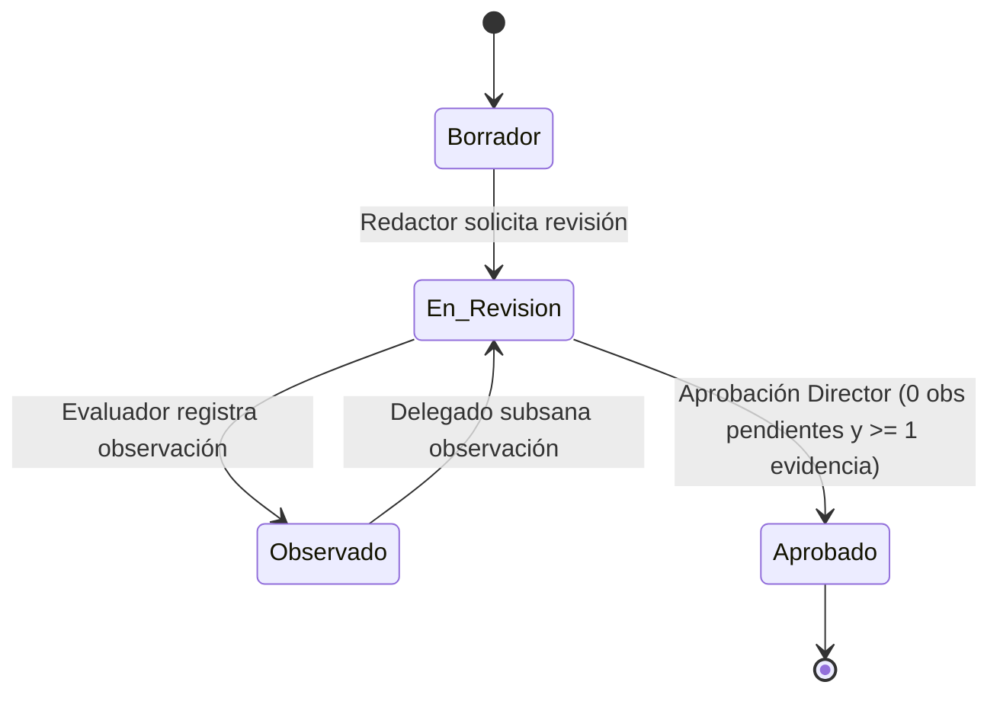

# Sistema de Seguimiento y Gestión al Rediseño Curricular
### Ingeniería en Sistemas — UAGRM (FICCT)
**Materia:** INF-513 Tecnología Web  
**Docente Evaluador:** Ing. Evans Balcázar Veizaga  
**Arquitectura:** 3 Capas Desacoplada (Laravel 13 REST API + React 19 / TypeScript + PostgreSQL 16)  

---

## 1. Resumen Ejecutivo del Proyecto

El presente proyecto implementa la solución web integral para el **seguimiento, redacción técnica, auditoría y compilación oficial del Rediseño Curricular (Plan 187-4)** de la carrera de Ingeniería en Sistemas de la Universidad Autónoma Gabriel René Moreno (UAGRM).

La solución reemplaza y moderniza el prototipo académico previo implementado en Java con comandos por correo electrónico (`email-P`), transitando hacia una **arquitectura desacoplada de 3 capas** con alta usabilidad, estricto control de acceso basado en roles, máquina de estados con pistas inmutables de auditoría, motor de detección de ciclos en prerrequisitos (DAG), repositorio digital facetado de evidencias normativas, compilador oficial de planes y estadísticas completas del negocio.

### Exclusión Justificada del Módulo de Pagos (ADR-004)
> [!NOTE]
> **Decisión de Arquitectura ADR-004:**  
> Por la naturaleza de la plataforma (un sistema interno de gestión académica e institucional para el comité docente de rediseño curricular sin cobros de matrícula ni transacciones arancelarias), el módulo de pagos electrónicos ha sido **formalmente excluido y justificado**, reorientando el esfuerzo técnico hacia la robustez de las reglas de negocio, la auditoría y el compilador documental.

---

## 2. Pila Tecnológica (Tech Stack)

| Capa | Tecnologías Empleadas | Propósito / Funcionalidad |
| :--- | :--- | :--- |
| **Backend (API RESTful)** | **Laravel 13**, PHP 8.5+, Laravel Sanctum | Controladores REST, inyección de dependencias, Form Requests con validación estricta en español, middlewares de auditoría y servicios desacoplados. |
| **Base de Datos** | **PostgreSQL 16** (`db_email`) | Almacenamiento relacional, claves foráneas, restricciones de integridad referencial (`chk_no_autorequisito`), índices y secuencias automáticas. |
| **Frontend (SPA)** | **React 19**, **Vite 7**, **TypeScript 5.9** | Arquitectura orientada a componentes, interfaces tipadas de dominio, Axios con interceptor Bearer, React Router v7. |
| **Diseño y Estilos** | **Tailwind CSS v4**, Lucide React | Variables CSS temáticas dinámicas (`data-theme`, `data-mode`, `data-font-size`, `data-contrast`), diseño responsivo. |
| **Grafos y Visualización** | **@xyflow/react** (React Flow) | Renderizado interactivo del Grafo Acíclico Dirigido (DAG) de materias y prerrequisitos con soporte de arrastre y zoom. |

---

## 3. Matriz de Cumplimiento de Requisitos Académicos (INF-513)

| # | Requisito Académico INF-513 | Implementación en el Proyecto |
| :-: | :--- | :--- |
| **1** | **Arquitectura de 3 capas con Base de Datos** | Capa de datos en PostgreSQL 16 relacional; capa lógica de negocio en Laravel 13; capa de presentación en React 19 + TypeScript. |
| **2** | **Al menos 2 roles del negocio (sin admin) y menú dinámico** | Tres roles académicos reales: **Director** (1), **Delegado** (2) e **Invitado** (3). El menú se carga dinámicamente desde la base de datos vía `/api/auth/menu` según el rol autenticado. |
| **3** | **API RESTful (Laravel - React)** | 42 endpoints RESTful documentados con códigos HTTP semánticos (200, 201, 401, 403, 422). Comunicación vía Axios con tokens Bearer Sanctum. |
| **4** | **Control de Acceso (Matriz) y Bitácora** | Middleware `AuditLogMiddleware` que registra automáticamente inicios de sesión (exitosos y fallidos), recursos accedidos, IP, User-Agent y timestamp. |
| **5** | **Estilos propios: 3 temas, Día/Noche y Accesibilidad** | 3 temas seleccionables (**Adultos**, **Jóvenes**, **Niños**); modo **Día/Noche** automático según hora local del cliente; escalado de fuente (**Normal, Grande, Extra Grande**) y conmutador de **Alto Contraste**. |
| **6** | **Validación de entradas con mensajes en español** | Validación tanto en Frontend como en FormRequests de Backend con mensajes claros en español. Se respeta la política estricta de contraseñas de la UAGRM (`8-25 caracteres`, patrón `^[a-zA-Z0-9ñÑ]+$`, sin símbolos). |
| **7** | **Contador de visitas en el pie de página persistido en DB** | Componente `Footer.tsx` invoca `POST /api/site/visita`, persistiendo y acumulando las visitas de cada ruta y globales en la tabla `contador_visitas`. |
| **8** | **Estadísticas del negocio y de acceso** | Tablero `/estadisticas` con avance por componentes, productividad de delegados, conteo de observaciones; módulo `/bitacora` con % de efectividad de logins y Top 10 de recursos más accedidos. |
| **9** | **Búsqueda del negocio en encabezado** | Barra global en `Header.tsx` que consulta `GET /api/site/busqueda?q=...` con búsqueda transversal sobre Asignaturas, Capítulos, Evidencias Normativas y Planes con menú desplegable interactivo. |
| **10**| **Módulo de pagos** | Excluido con justificación técnica e institucional (ADR-004). |

---

## 4. Casos de Uso del Negocio Aprobados (CU1 a CU8)

- **CU1: Gestión de Usuarios, Roles y Foto de Perfil** (`/usuarios`): Registro y administración de cuentas docentes con carga de fotografías e imposición de políticas de acceso.
- **CU2: Plan de Estudios y Malla Curricular** (`/malla`): Distribución semestral de asignaturas (Semestres 1 al 10), conteo de horas teóricas, prácticas y créditos académicos.
- **CU3: Grafo Interactivo de Prerrequisitos y Detección de Ciclos** (`/grafo`): Visualización DAG en React Flow, trazado de dependencias hacia adelante/atrás y algoritmo BFS de detección de ciclos con rechazo `422`.
- **CU4: Estructura del Rediseño y Capítulos** (`/redisenio`): Organización modular por componentes curriculares, creación de capítulos y asignación de docentes redactores.
- **CU5: Control de Estados, Observaciones Técnicas y Auditoría** (`/capitulos/:id`): Máquina de estados finita (*Borrador*, *En Revisión*, *Observado*, *Aprobado*) con bloqueo de aprobación si hay observaciones pendientes o falta evidencia, más bitácora inmutable en `historial_modificacion`.
- **CU6: Repositorio Digital de Evidencias y Búsqueda Facetada** (`/evidencias`): Archivo documental con subida de resoluciones PDF/imágenes, vinculación a capítulos y filtrado multicriterio facetado por tipo de norma, emisor y fecha.
- **CU7: Tablero de Avance y Compilador Oficial del Rediseño** (`/dashboard` y `/reporte-final`): Resumen ejecutivo de avance y compilación formal del documento curricular listo para imprimir o exportar a PDF (`@media print`).
- **CU8: Reportes y Estadísticas del Negocio** (`/estadisticas`): Métricas de cumplimiento curricular por componente y productividad técnica de docentes y delegados.

---

## 5. Guía de Instalación y Despliegue Paso a Paso

Sigue estas instrucciones detalladas para instalar el proyecto desde cero luego de clonar el repositorio de GitHub.

### Prerrequisitos del Sistema
Asegúrate de tener instalados los siguientes entornos en tu máquina local:
- **PHP:** Versión `8.2` o superior (con extensiones `pdo`, `pdo_pgsql`, `mbstring`, `openssl`).
- **Composer:** Gestor de paquetes PHP.
- **Node.js:** Versión `18.0` o superior (con `npm`).
- **PostgreSQL:** Versión `15` o `16` en ejecución local en el puerto `5432`.
- **Git:** Para clonar el repositorio.

---

### Paso 1: Clonar el Repositorio
Abre tu terminal y ejecuta:
```bash
git clone https://github.com/tu-usuario/tu-repositorio.git TW-php
cd TW-php
```

---

### Paso 2: Configuración del Backend (Laravel)

1. **Ingresar al directorio del backend:**
   ```bash
   cd backend
   ```

2. **Instalar dependencias de PHP:**
   ```bash
   composer install
   ```

3. **Configurar el archivo de entorno (`.env`):**
   Copia el archivo de ejemplo:
   ```bash
   cp .env.example .env
   ```
   Abre el archivo `.env` y asegúrate de configurar la conexión a PostgreSQL:
   ```env
   APP_NAME="Rediseño Curricular UAGRM"
   APP_ENV=local
   APP_KEY=
   APP_DEBUG=true
   APP_URL=http://127.0.0.1:8000

   DB_CONNECTION=pgsql
   DB_HOST=127.0.0.1
   DB_PORT=5432
   DB_DATABASE=db_email
   DB_USERNAME=postgres
   DB_PASSWORD=tu_password_de_postgres
   ```
   *(Nota: Asegúrate de crear la base de datos `db_email` en PostgreSQL si aún no existe: `createdb -U postgres db_email` o vía pgAdmin).*

4. **Generar la clave de la aplicación:**
   ```bash
   php artisan key:generate
   ```

5. **Configurar el enlace de almacenamiento público (Storage Link):**
   En sistemas Linux / macOS:
   ```bash
   php artisan storage:link
   ```
   *En sistemas Windows (por restricciones de enlaces simbólicos sin privilegios de administrador), puedes crear una unión de directorio (Directory Junction):*
   ```cmd
   cmd /c mklink /J "public\storage" "storage\app\public"
   ```

6. **Ejecutar migraciones y sembrar datos de prueba:**
   ```bash
   php artisan migrate:fresh --seed
   ```
   > [!TIP]
   > El `DatabaseSeeder` sincroniza automáticamente las secuencias primarias de PostgreSQL (`setval`), asegurando que nuevas inserciones no generen colisiones de clave primaria (`duplicate key value violates unique constraint`).

7. **Iniciar el servidor de desarrollo del Backend:**
   ```bash
   php artisan serve --port=8000
   ```
   El backend quedará operativo en: `http://127.0.0.1:8000`

---

### Paso 3: Configuración del Frontend (React + Vite)

1. **Abrir una nueva terminal e ingresar a la carpeta del frontend:**
   ```bash
   cd frontend
   ```

2. **Instalar dependencias de Node.js:**
   ```bash
   npm install
   ```

3. **Verificar o construir para producción:**
   ```bash
   npm run build
   ```
   *Debe compilar con 0 errores de TypeScript.*

4. **Iniciar el servidor de desarrollo del Frontend:**
   ```bash
   npm run dev
   ```
   El frontend quedará operativo en: `http://localhost:5173`

---

## 6. Cuentas de Acceso y Credenciales de Demostración

La base de datos viene sembrada con cuentas de usuario correspondientes a los roles académicos del negocio:

| Usuario (Username) | Correo Registrado | Contraseña | Rol del Negocio | Botón en Login / Alcance |
| :--- | :--- | :--- | :--- | :--- |
| **`director`** | `grupo02sa@tecnoweb.org.bo` | `Director123!` | **Director** | Cuenta institucional: Ing. Evans Balcázar (Director de Carrera). |
| **`cmarca`** | `marcacarlosestudio@gmail.com` | `Carlos123#` | **Director** | Botón rápido: **Carlos Marca** (Gestión de usuarios, aprobación final, auditoría y estadísticas). |
| **`luisecv`** | `luis.ecv1111@gmail.com` | `Luis2026ñ#` | **Director** | Botón rápido: **Luis Fernando** (Rediseño, redacción de capítulos, subsanación y evidencias). |
| **`tvalda`** | `taniavaldadonozo@gmail.com` | `Tania2026ñ!` | **Director** | Botón rápido: **Tania Valda** (Revisión técnica de capítulos y observaciones). |
| **`croca`** | `croca@uagrm.edu.bo` | `Delegado2026ñ$` | **Delegado** | Botón rápido: **Carlos Roca** (Redactor y revisor técnico de capítulos). |
| **`mmendoza`** | `mmendoza@uagrm.edu.bo` | `Invitado2026ñ*` | **Invitado** | Botón rápido: **Mario Mendoza** (Acceso de solo lectura a malla curricular, grafo y evidencias). |

> [!IMPORTANT]
> **Política de Seguridad y Blindaje de Accesos:**  
> 1. **Complejidad de Contraseña:** Toda contraseña debe tener entre **8 y 25 caracteres**, incluir al menos **1 mayúscula (A-Z o Ñ)**, **1 minúscula (a-z o ñ)**, **1 número (0-9)** y **1 símbolo especial permitido (`@$!%*#?&_\-.`)**. No se admiten espacios ni caracteres no autorizados.
> 2. **Defensa Anti Fuerza Bruta:** Máximo 5 intentos fallidos por credencial e IP. Al 5to fallo consecutivo, el backend bloquea las solicitudes por **5 minutos (300 s)** retornando código HTTP `429`, la interfaz activa un modal de bloqueo con cuenta regresiva en vivo, y se registra el evento `bloqueo_fuerza_bruta` en la bitácora inmutable.
> 3. **Blindaje de Rutas (RBAC) y 403 Híbrido:** Endpoints administrativos `/api/usuarios` y `/api/bitacora` protegidos mediante middleware `role:Director`. En la SPA, si un rol sin privilegios intenta acceder manualmente a rutas administrativas, se renderiza una vista con código `403 - Acceso Denegado` que redirige automáticamente tras 3 segundos al dashboard del usuario.
> 4. **Recuperación Administrativa de Contraseña y Cambio Obligatorio:** El rol Director puede restablecer la contraseña de cualquier usuario a una clave temporal institucionalmente válida (sugerencia rápida: `Uagrm2026ñ*`). El backend marca la bandera `debe_cambiar_password = true`, limpia de inmediato cualquier bloqueo por fuerza bruta y audita la acción. Al autenticarse con la clave temporal, la SPA despliega de forma obligatoria el modal de actualización definitiva, impidiendo la navegación hasta definir una contraseña personal.

---

## 7. Catálogo Completo de Endpoints RESTful (42 Rutas)

### 7.1. Autenticación, Sesión y Menú Dinámico
| Método | Endpoint | Descripción | Acceso |
| :--- | :--- | :--- | :--- |
| `POST` | `/api/auth/login` | Autentica usuario y emite Token Bearer Sanctum | Público |
| `POST` | `/api/auth/logout` | Revoca y destruye el token activo | Autenticado |
| `GET` | `/api/auth/me` | Retorna los datos del usuario en sesión | Autenticado |
| `GET` | `/api/auth/menu` | Retorna los ítems de navegación según el rol del usuario | Autenticado |
| `POST` | `/api/auth/perfil` | Actualización de perfil propio (nombre, foto, contraseña voluntaria) | Autenticado |
| `POST` | `/api/auth/cambiar-password-obligatorio` | Establece la contraseña definitiva tras reseteo administrativo temporal | Autenticado |

### 7.2. Sitios, Visitas y Búsqueda Global
| Método | Endpoint | Descripción | Acceso |
| :--- | :--- | :--- | :--- |
| `POST` | `/api/site/visita` | Registra e incrementa contador de visitas de una ruta | Público |
| `GET` | `/api/site/busqueda` | Búsqueda transversal en asignaturas, capítulos, normas y planes | Público |

### 7.3. Malla Curricular y Grafo de Prerrequisitos (DAG)
| Método | Endpoint | Descripción | Acceso |
| :--- | :--- | :--- | :--- |
| `GET` | `/api/planes` | Lista de planes de estudio registrados | Autenticado |
| `POST` | `/api/planes` | Registro de nuevo plan de estudios | Director |
| `GET` | `/api/planes/{idPlan}/asignaturas` | Listado semestral de asignaturas del plan | Autenticado |
| `POST` | `/api/asignaturas` | Crea una nueva asignatura con créditos y horas | Delegado/Director |
| `GET` | `/api/planes/{idPlan}/grafo` | Formato `{nodes, edges}` optimizado para React Flow | Autenticado |
| `POST` | `/api/prerrequisitos` | Vincula prerrequisito con validación de ciclos (BFS) | Delegado/Director |
| `DELETE`| `/api/prerrequisitos` | Desvincula una relación de prerrequisito | Delegado/Director |
| `GET` | `/api/asignaturas/{id}/dependencias`| Cadena completa de dependencias anteriores y posteriores | Autenticado |

### 7.4. Componentes, Capítulos, Máquina de Estados y Control de Versiones (Diff)
| Método | Endpoint | Descripción | Acceso |
| :--- | :--- | :--- | :--- |
| `GET` | `/api/planes/{idPlan}/componentes` | Estructura temática con capítulos y estados | Autenticado |
| `POST` | `/api/componentes` | Crea un componente curricular | Delegado/Director |
| `POST` | `/api/capitulos` | Registra un capítulo en estado Borrador | Delegado/Director |
| `GET` | `/api/capitulos/{id}` | Detalle completo de capítulo (evidencias, observaciones, historial) | Autenticado |
| `PUT` | `/api/capitulos/{id}/estado` | Transición de máquina de estados con validación de aprobación | Delegado/Director |
| `GET` | `/api/estados-capitulo` | Catálogo maestro de estados de capítulo | Autenticado |
| `POST` | `/api/capitulos/{id}/redactores` | Asigna docentes redactores a un capítulo | Director |
| `POST` | `/api/capitulos/{id}/observaciones` | Registra observación técnica y conmuta a *Observado* | Delegado/Director |
| `PUT` | `/api/observaciones/{id}/subsanar` | Subsanación de observación técnica por delegado redactor | Delegado/Director |
| `GET` | `/api/capitulos/{id}/historial` | Bitácora inmutable de auditoría del capítulo | Autenticado |
| `GET` | `/api/capitulos/{id}/versiones` | Historial cronológico de versiones y texto extraído para comparador Diff | Autenticado |
| `POST` | `/api/capitulos/{id}/versiones` | Publica nueva versión de entrega/subsanación (PDF/MD/TXT) y sincroniza contenido | Delegado/Director |

### 7.5. Repositorio de Evidencias Digitales
| Método | Endpoint | Descripción | Acceso |
| :--- | :--- | :--- | :--- |
| `GET` | `/api/evidencias` | Búsqueda facetada con filtros combinados (tipo, emisor, fechas) | Autenticado |
| `POST` | `/api/evidencias` | Carga de archivo PDF/imagen y metadatos de resolución | Delegado/Director |
| `POST` | `/api/evidencias/vincular-capitulo` | Vincula evidencia normativa a un capítulo | Delegado/Director |
| `POST` | `/api/evidencias/desvincular-capitulo` | Desvincula evidencia de un capítulo | Delegado/Director |

### 7.6. Tablero de Control, Bitácora y Compilador Oficial
| Método | Endpoint | Descripción | Acceso |
| :--- | :--- | :--- | :--- |
| `GET` | `/api/dashboard/metricas` | Resumen de avance, conteo por estado y alertas de observados | Autenticado |
| `GET` | `/api/dashboard/planes/{id}/componentes` | Estadísticas porcentuales de cumplimiento por componente | Autenticado |
| `GET` | `/api/dashboard/productividad` | Estadísticas de capítulos y observaciones por docente | Autenticado |
| `GET` | `/api/dashboard/planes/{id}/reporte-final`| Compilador de datos para el reporte oficial estructurado | Autenticado |
| `GET` | `/api/bitacora` | Registro transaccional de auditoría, accesos y métricas de login | Director |

### 7.7. Gestión de Usuarios y Matriz de Acceso
| Método | Endpoint | Descripción | Acceso |
| :--- | :--- | :--- | :--- |
| `GET` | `/api/roles` | Catálogo de roles de negocio | Director |
| `GET` | `/api/usuarios` | Listado de usuarios con foto y rol | Director |
| `POST` | `/api/usuarios` | Registro de nuevo usuario con foto y validación de contraseña | Director |
| `POST` | `/api/usuarios/{id}/reset-password` | Restablecimiento administrativo de clave temporal (activa cambio obligatorio) | Director |

### 7.8. Convocatorias Oficiales a Reuniones de Comisión
| Método | Endpoint | Descripción | Acceso |
| :--- | :--- | :--- | :--- |
| `GET` | `/api/convocatorias` | Listado cronológico de convocatorias emitidas con destinatarios | Director |
| `POST` | `/api/convocatorias` | Emite convocatoria formal, compila carta PDF, genera .ics, despacha vía SMTP y audita | Director |
| `GET` | `/api/convocatorias/{id}/pdf` | Descarga o visualización directa de la carta oficial en formato PDF | Autenticado |

---

## 8. Funcionalidades Destacadas del Negocio



1. **Máquina de Estados Finita con Validación Condicional:**  
   Un capítulo no puede avanzar al estado **Aprobado** a menos que cumpla dos precondiciones técnicas estrictas:
   - Contar con `0` observaciones pendientes de subsanación.
   - Tener vinculada al menos `1` evidencia normativa o resolución formal.
2. **Motor de Grafos Acíclicos (DAG) con Detección BFS:**  
   Al intentar enlazar materias mediante prerrequisitos, el sistema ejecuta una búsqueda en anchura (BFS) sobre el grafo de dependencias. Si el nuevo enlace induciría un bucle cíclico (ej. $A \to B \to C \to A$), la operación es abortada automáticamente retornando un código `422 Unprocessable Content` y un mensaje de error descriptivo en español.
3. **Pistas de Auditoría Inmutables:**  
   Cada cambio de estado, observación registrada y subsanación queda grabada de forma permanente en la tabla `historial_modificacion`, vinculando la fecha, la justificación técnica, el usuario responsable y los estados anterior y nuevo.
4. **Compilador Oficial de Rediseño Curricular:**  
   Reúne de forma dinámica la portada institucional, los objetivos de formación, el perfil de egreso, la malla tabular semestral completa con prerrequisitos, los capítulos aprobados con su redacción íntegra y el anexo legal de evidencias normativas vigentes, con reglas `@media print` para exportación directa a documento PDF.

---

## 9. Estructura de Directorios del Proyecto

```
TW-php/
├── .agents/                      # Documentación y reglas de trabajo del asistente
│   ├── arquitectura.md           # Registro de ADRs (ADR-001 al ADR-004)
│   └── rules/reglas.md           # Directivas de gobernanza y directrices
├── backend/                      # API RESTful en Laravel 13
│   ├── app/
│   │   ├── Http/Controllers/Api/ # 6 Controladores RESTful principales
│   │   ├── Http/Middleware/      # AuditLogMiddleware (registro de bitácora)
│   │   ├── Http/Requests/        # FormRequests con validación en español
│   │   ├── Models/               # 12 Modelos Eloquent con relaciones
│   │   └── Services/             # Lógica desacoplada (Prerrequisitos, Estados, Auditoría, Reportes)
│   ├── database/
│   │   ├── migrations/           # 17 migraciones ordenadas (27 tablas en PostgreSQL)
│   │   └── seeders/              # Seeders iniciales con Plan 187-4 y usuarios
│   ├── routes/
│   │   └── api.php               # Definición de las 38 rutas RESTful
│   └── storage/app/public/       # Directorio de almacenamiento para fotos y evidencias
├── frontend/                     # Aplicación SPA en React 19 + TypeScript
│   ├── src/
│   │   ├── components/
│   │   │   ├── graph/            # CustomSubjectNode para React Flow
│   │   │   └── layout/           # Header, Sidebar dinámico, Footer y Layout
│   │   ├── context/              # AuthContext (Sesión y menú) y ThemeContext (Temas/Accesibilidad)
│   │   ├── pages/                # 9 Vistas principales del sistema
│   │   ├── services/api.ts       # Cliente Axios con interceptor Sanctum
│   │   └── types/index.ts        # Interfaces tipadas completas del dominio
│   ├── vite.config.ts            # Configuración de Vite y proxy a Laravel (:8000)
│   └── package.json
└── README.md                     # Documento de instalación y referencia técnica
```

---

## 10. Información Académica

- **Universidad:** Universidad Autónoma Gabriel René Moreno (UAGRM)
- **Facultad:** Facultad de Ciencias de la Computación y Telecomunicaciones (FICCT)
- **Carrera:** Ingeniería en Sistemas
- **Materia:** INF-513 Tecnología Web
- **Docente:** Ing. Evans Balcázar Veizaga
- **Semestre:** 2-2026
- **Santa Cruz de la Sierra, Bolivia**

---

## 11. Guía Universal de Despliegue y Cambio de Servidor (Subcarpeta o Subdominio)

Este proyecto está diseñado bajo una **arquitectura monorepo desacoplada** (`backend/` en Laravel y `frontend/` en React). Para desplegarlo en cualquier servidor web Apache (sea en TecnoWeb, un VPS, cPanel o servidor institucional), el sistema soporta dos modalidades de acceso:
1. **Modalidad A: Por Subcarpeta / Subdirectorio** (ejemplo: `https://servidor.edu.bo/facultad/proyecto`)
2. **Modalidad B: Por Subdominio Dedicado o Raíz** (ejemplo: `https://rediseño.ficct.uagrm.edu.bo` o `http://localhost/`)

---

### 1. Puntos de Configuración según la Modalidad del Servidor

Solo existen **4 archivos de configuración** que deben ajustarse según la URL donde residirá el sistema:

| # | Archivo a Modificar | Directiva / Variable | Caso A: Subcarpeta<br>`https://servidor.com/carrera/proyecto` | Caso B: Subdominio o Raíz<br>`https://subdominio.servidor.com/` |
| :-: | :--- | :--- | :--- | :--- |
| **1** | `/.htaccess` *(raíz del monorepo)* | `RewriteBase` | `RewriteBase /carrera/proyecto/` | `RewriteBase /` |
| **2** | `/backend/public/.htaccess` | `RewriteBase` | `RewriteBase /carrera/proyecto/` | `RewriteBase /` |
| **3** | `/frontend/vite.config.ts` | `base: command === 'build'` | `'/carrera/proyecto/'` | `'/'` |
| **4** | `/backend/.env` *(en el servidor)* | `APP_URL` | `https://servidor.com/carrera/proyecto` | `https://subdominio.servidor.com` |

> [!IMPORTANT]
> - **Regla de las barras (`/`):** En `/.htaccess`, `/backend/public/.htaccess` y `vite.config.ts`, la ruta siempre debe comenzar y terminar con barra inclinada (ejemplo: `/inf513/grupo02sa/inf513-proyecto2/` o `/`).
> - **Código React Agnóstico:** El enrutador (`App.tsx`) y el cliente Axios (`api.ts`) consumen dinámicamente `import.meta.env.BASE_URL`, por lo que **no requieren modificaciones manuales de código** al cambiar de servidor.

---

### 2. Blindaje Automático en `backend/public/index.php` (Front Controller)

En `backend/public/index.php` se implementó una normalización automática del entorno:
```php
foreach (['SCRIPT_NAME', 'PHP_SELF'] as $key) {
    if (isset($_SERVER[$key]) && str_contains($_SERVER[$key], '/backend/public/index.php')) {
        $_SERVER[$key] = str_replace('/backend/public/index.php', '/index.php', $_SERVER[$key]);
    }
}
```
**¿Por qué es importante?**
- Permite que Apache redirija transparentemente desde la raíz del monorepo hacia `backend/public/` sin que Symfony o Laravel se confundan con el método HTTP (evitando el error `The POST method is not supported`).
- **No requiere modificarse nunca al cambiar de servidor**, ya que detecta la estructura interna de carpetas de forma 100% agnóstica al nombre del dominio o la ruta del host.

---

### 3. Checklist Completo para Migrar a un Nuevo Servidor desde Cero

Cuando lleves el proyecto a un nuevo servidor o equipo, sigue estos pasos ordenados:

#### Paso 1: Clonar el Repositorio
```bash
git clone https://github.com/TU_USUARIO/TU_REPOSITORIO.git mi-proyecto
cd mi-proyecto
```

#### Paso 2: Configurar Variables de Entorno (`backend/.env`)
Crea el archivo `backend/.env` configurando la base de datos y la URL del nuevo servidor:
```env
APP_NAME="Rediseño Curricular FICCT"
APP_ENV=production
APP_KEY=base64:fpcobfEL8fCJug8nB+GhvMja+QBrzFYoV6Fy8mKYrB4=
APP_DEBUG=false
APP_URL=https://TU_NUEVO_DOMINIO/TU_RUTA

DB_CONNECTION=pgsql
DB_HOST=127.0.0.1
DB_PORT=5432
DB_DATABASE=TU_BASE_DATOS
DB_USERNAME=TU_USUARIO
DB_PASSWORD=TU_PASSWORD
```

#### Paso 3: Ajustar las 4 Directivas de Ruta
Verifica los valores de `RewriteBase` en los dos archivos `.htaccess`, la propiedad `base` en `frontend/vite.config.ts` y `APP_URL` en `backend/.env` según la tabla de la Sección 1.

#### Paso 4: Instalar Dependencias del Backend
```bash
cd backend
composer install --no-dev --optimize-autoloader
```

#### Paso 5: Permisos de Carpetas en Linux
Asegura permisos de lectura y escritura para el servidor web en las carpetas de almacenamiento y caché:
```bash
chmod -R 775 storage bootstrap/cache
```

#### Paso 6: Ejecutar Migraciones y Datos Iniciales
```bash
php artisan migrate:fresh --seed --force
```

#### Paso 7: Compilar y Sincronizar el Frontend (SPA)
En tu máquina local (o en el servidor si tiene Node.js):
```powershell
# En la carpeta frontend:
npm run build

# Copiar el contenido generado a la carpeta pública de Laravel:
Copy-Item -Path "dist/*" -Destination "../backend/public" -Recurse -Force
```

#### Paso 8: Optimizar Caché de Producción
En el servidor, dentro de `backend/`:
```bash
php artisan config:clear
php artisan route:clear
php artisan view:clear
php artisan config:cache
php artisan route:cache
php artisan view:cache
```


